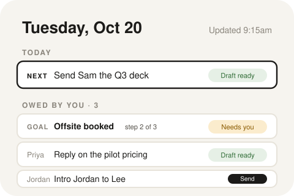
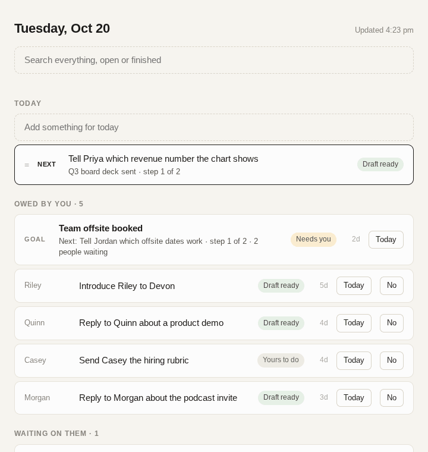

  

# Today

  

Didn't work? Create a Studio workspace and paste this to your agent:
` /use-template https://github.com/kanjun/today-app`

## Why you care

A daily list of what you owe people from Slack and email, with replies drafted for you to send

People ask things of you all day, across Slack threads and email, and the asks get buried: you find out a week later that someone was waiting on a one-line answer. Today keeps one short list of what you actually owe people, clears what you already handled anywhere, and has a reply drafted for each thing so most of them take one tap. Refreshes every 30 minutes.

## How to use it

  

Open the **Today** window. Every 30 minutes it updates itself from your inputs; you never run anything by hand.

- **Owed by you** lists everything waiting on you, oldest first. Related asks are grouped into **goals** ("Q3 board deck sent") with ordered steps, so you see the next step rather than five separate pings. Each row says whether a draft is ready, it needs an answer from you, or it is yours to do.
- **Open an item** to see who asked and their exact words, what the assistant did, and the reply it wrote in your voice. "See the conversation" shows the original thread; "Open in Slack/Gmail" jumps to it.
- **Change the draft in plain words**: type "shorter, and offer Thursday at 2 instead" and press Redo the draft. Tick "Remember this for all drafts" to make it a standing rule.
- **Answer its questions** when it needs a fact only you have (it offers choices), and it writes the reply from your answers.
- **Send** posts the reply in the Slack thread or replies on the email thread, only when you press it. **Save as Gmail draft** puts it in your drafts instead. Intro emails and proposed calendar events get their own Send and Add buttons.
- **Done already** or **No** clear an item; No writes a kind decline when one is owed, or just lets it go. Pick a few items with **Today** to build the day's list, and drag to reorder it.
- **Search** finds anything, open or finished, including words that only appear inside a conversation.

Before it has anything to read, the page shows **Connect a source**: Today needs an email digest per inbox and a folder of Slack captures (formats in [the app's README](system/apps/today/README.md)), plus your name and inboxes in `data/.apps/today/settings.json`.

## Ideas for making it yours

- Add a source beyond email and Slack: anything that can write a small JSON item (a CRM follow-up, a GitHub review request) can feed the same list.
- Change the cadence: run the update hourly instead of every 30 minutes, or move the morning regrouping to the evening so tomorrow's list is ready when you sit down.
- Give the assistant house rules up front, such as "always sign off with my first name" or "never propose meetings before 10am", as standing draft rules.
- Send a short morning summary of the Today list to yourself in Slack or email.
- Turn the "Waiting on them" section into automatic polite nudges after a few days of silence, still sent only on your tap.

## What this is

This repository is a published **Imbue Studio template**: a clean, bootable
snapshot of what an agent built, ready to adapt into your own. It is NOT the
generic workspace template -- it is this specific project.

[`template.md`](template.md) is the full manifest -- what it is, how it
works, what it needs to run, and what to adapt -- with the
machine-readable half (recipe, requirements, and the environment it needs
installed) in [`template.toml`](template.toml).
