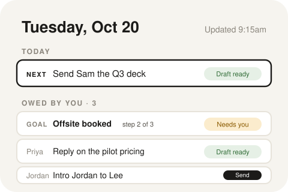
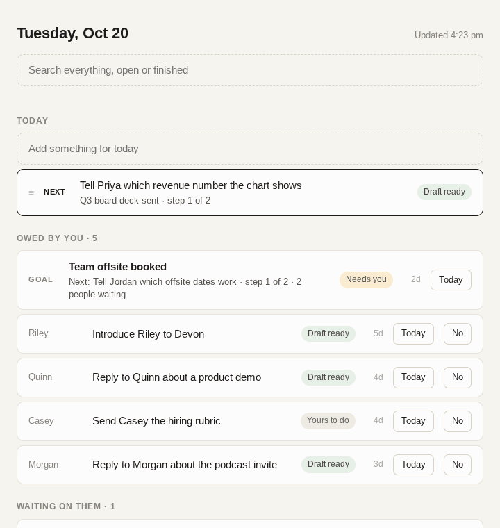

  

# Today

  

Didn't work? Create a Studio workspace and paste this to your agent:
` /use-template https://github.com/kanjun/today-app`

## Why you care

A daily list of what you owe people from Slack and email, with replies drafted for you to send

People ask things of you all day, across Slack threads and email, and the asks get buried: you find out a week later that someone was waiting on a one-line answer. Today keeps one short list of what you actually owe people, clears what you already handled anywhere, and has a reply drafted for each thing so most of them take one tap. Refreshes every 30 minutes.

## How to use it

  

Open the **Today** window. Every 30 minutes it updates itself from your inputs; you never run anything by hand.

- **Today** leads with **Now**, the few things to do first, then your lists: **Replies ready** (one read and Send each), **Quick answers** (a decision only you have), **Yours to do** and **Waiting on**. Each task's list is decided by reading its whole conversation, and anything you already handled anywhere drops off.
- **Open a task** to see its card: the whole thread, who asked and their exact words, its checklist and notes, and the reply written in your voice. "See the whole conversation" shows the original; "Open in Slack/Gmail" jumps to it.
- **Tell the assistant what to change in plain words** in the card's box ("shorter, and offer Thursday at 2 instead"), or tap one of the options it offers. Other options takes back the last thing it did.
- **Send** posts the reply in the Slack thread or on the email thread, only when you press it, and waits ten seconds for Undo. **Save as Gmail draft** puts it in your drafts instead. Intro emails and proposed calendar events get their own buttons.
- **Set a date** on any task from its date spot: Today, Tomorrow, a calendar, or words like "next Friday".
- **Inbox** takes quick captures from your phone and files each one for you, with the date and project your words give; **Week** plans your mornings; **Projects** shows your projects, soonest due first, and groupings Today suggests; **Someday** is an outline for later.
- **Search** finds anything, open or finished, including words that only appear inside a conversation.

Before it has anything to read, the page shows **Connect a source**: Today reads your connected Slack by itself on its next update, and needs an email digest per inbox (format in [the app's README](system/apps/today/README.md)), plus your name and inboxes in `data/.apps/today/settings.json`.

## Ideas for making it yours

- Add a source beyond email and Slack: anything that can write a small JSON item (a CRM follow-up, a GitHub review request) can feed the same list.
- Change the cadence: run the update hourly instead of every 30 minutes, or once more in the evening so tomorrow's list is ready when you sit down.
- Give the assistant house rules up front, such as "always sign off with my first name" or "never propose meetings before 10am", in the rules every AI in Today reads (`system/apps/today/src/today/user_rules.py`).
- Send a short morning summary of the Today list to yourself in Slack or email.
- Turn the "Waiting on" list into automatic polite nudges after a few days of silence, still sent only on your tap.

## What this is

This repository is a published **Imbue Studio template**: a clean, bootable
snapshot of what an agent built, ready to adapt into your own. It is NOT the
generic workspace template -- it is this specific project.

[`template.md`](template.md) is the full manifest -- what it is, how it
works, what it needs to run, and what to adapt -- with the
machine-readable half (recipe, requirements, and the environment it needs
installed) in [`template.toml`](template.toml).
